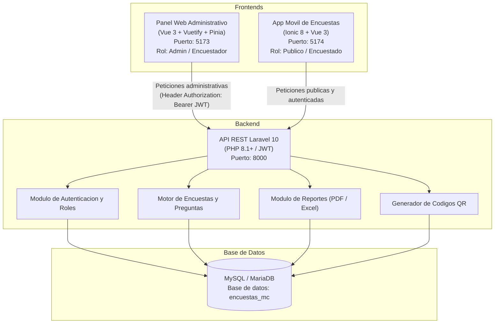

# LaQuestionES - Sistema de Gestion de Encuestas e Indicadores

Proyecto final de las materias: UFDS, Metodologias de Desarrollo de Software y Desarrollo de Aplicaciones Moviles.

---

## Descripcion del Proyecto

LaQuestionES es una plataforma para la creacion, distribucion, recoleccion y analisis estadistico de encuestas publicas y privadas para instituciones y organizaciones.

El sistema esta dividido en tres componentes principales:

1. **Backend (API REST):** Desarrollado en **Laravel 10**, encargado de la logica de negocio, autenticacion con JWT, control de roles y permisos (RBAC), auditoria de cambios, generacion de codigos QR y exportacion de reportes en PDF y Excel.
2. **Frontend Web (Panel Administrativo):** Desarrollado en **Vue 3** con **Vuetify** y **Pinia**. Es el panel utilizado por administradores y encuestadores para disenar formularios dinamicos, gestionar estados de encuestas, ver metricas en tiempo real y administrar catalogos.
3. **Frontend Movil (App / Portal Ciudadano):** Desarrollado en **Ionic 8** con **Vue 3**. Es una interfaz adaptada a dispositivos moviles para que los usuarios o ciudadanos respondan encuestas publicas de manera rapida y tactil sin necesidad de registro obligatorio, guardando localmente el historial de encuestas completadas.

---

## Arquitectura del Sistema



---

## Estructura del Repositorio

```text
LaQuestionES/
│
├── backend/                       # API RESTful en Laravel 10 (PHP 8.1+)
│   ├── app/                       # Modelos, Controladores y Middlewares
│   ├── config/                    # Configuracion general
│   ├── database/                  # Migraciones y seeders
│   ├── routes/
│   │   └── api.php                # Definicion de endpoints de la API
│   ├── composer.json              # Dependencias de PHP
│   └── .env                       # Variables de entorno del backend
│
├── frontend/                      # Panel Web de Administracion (Vue 3 + Vite)
│   ├── src/
│   │   ├── views/                 # Pantallas: Dashboard, Constructor, Reportes, Catalogos
│   │   ├── components/            # Componentes reutilizables
│   │   ├── services/              # Consumo de API con Axios
│   │   ├── stores/                # Estados de Pinia
│   │   └── router/                # Rutas web
│   ├── vite.config.js             # Configuracion de Vite con proxy hacia el puerto 8000
│   └── package.json               # Dependencias de Node.js
│
├── FrontedIonic/LaQuestionES-Ionic/ # App Movil (Ionic 8 + Vue 3)
│   ├── src/
│   │   ├── views/                 # Pantallas moviles: Lista, Detalle, Responder
│   │   ├── services/              # Consumo de la API publica
│   │   ├── utils/                 # Manejo de encuestas completadas en LocalStorage
│   │   └── router/                # Navegacion movil
│   ├── vite.config.js             # Configuracion de Vite para la app movil
│   └── package.json               # Dependencias de Ionic y Vue
│
├── encuestas_mc.sql               # Respaldo completo de la base de datos
├── .gitignore                     # Archivos ignorados por Git
└── README.md                      # Documentacion del proyecto
```

---

## Funcionalidades Principales

### Backend (Laravel 10)
- Control de acceso por roles (Administrador, Encuestador, Encuestado).
- Estructura dinamica de encuestas (Secciones, Preguntas con tipos texto, opcion multiple, seleccion unica, si/no y escala del 1 al 5).
- Flujo de estados de encuestas (Borrador, En revision, Publicada, Cerrada).
- Distribucion por enlace publico, codigo QR descargable (SVG) y envio de invitaciones por correo.
- Registro de auditoria de cambios (Change logs) y sesiones de usuario.
- Generacion y descarga de reportes en PDF y hojas de calculo Excel (.xlsx).

### Frontend Web (Vue 3)
- Panel de control principal con graficos interactivos mediante Chart.js.
- Editor visual de encuestas para organizar y reordenar secciones y preguntas con drag and drop.
- Gestion de unidades organizacionales y catalogos del sistema.
- Visualizacion detallada de respuestas individuales y metricas consolidadas.

### Frontend Movil (Ionic 8)
- Diseno pensado para pantallas tactiles de telefonos y tabletas.
- Listado de encuestas activas con filtro directo de completadas.
- Formulario de respuesta optimizado con botones de seleccion rapida y barra de progreso en vivo.
- Almacenamiento local del historial para identificar que encuestas ya fueron respondidas en el dispositivo.

---

## Requisitos del Sistema

- PHP 8.1 o superior
- Composer 2.x
- Node.js 18.x o 20.x y npm
- MySQL 8.x o MariaDB 10.4+ (XAMPP, Laragon o Docker)
- Git

---

## Instalacion y Configuracion

### 1. Base de datos
1. Iniciar el servicio de MySQL o MariaDB.
2. Crear una base de datos llamada `encuestas_mc`:
   ```sql
   CREATE DATABASE encuestas_mc CHARACTER SET utf8mb4 COLLATE utf8mb4_unicode_ci;
   ```
3. Importar el archivo `encuestas_mc.sql` ubicado en la raiz del proyecto en la base de datos recien creada.

### 2. Backend (Laravel)
1. Abrir una terminal y entrar a la carpeta:
   ```bash
   cd backend
   ```
2. Instalar dependencias:
   ```bash
   composer install
   ```
3. Revisar el archivo `.env` con los datos de conexion:
   ```env
   APP_NAME=LaQuestionES
   APP_ENV=local
   APP_URL=http://127.0.0.1:8000

   DB_CONNECTION=mysql
   DB_HOST=127.0.0.1
   DB_PORT=3306
   DB_DATABASE=encuestas_mc
   DB_USERNAME=root
   DB_PASSWORD=

   JWT_SECRET=JmoabNG0oJGpjOlp0ObyfuNljPHbktOMK7tRusXA6R3sppSvVFzvyn7gzzk2vTaG
   ```
4. Generar claves en caso de iniciar con un entorno limpio:
   ```bash
   php artisan key:generate
   php artisan jwt:secret
   ```
5. Iniciar el servidor:
   ```bash
   php artisan serve --port=8000
   ```
   El backend estara disponible en: `http://127.0.0.1:8000`

### 3. Frontend Web (Vue 3)
1. Abrir otra terminal y entrar a la carpeta:
   ```bash
   cd frontend
   ```
2. Instalar dependencias:
   ```bash
   npm install
   ```
3. Iniciar el entorno de desarrollo:
   ```bash
   npm run dev
   ```
   El panel web estara disponible en: `http://localhost:5173`

### 4. Frontend Movil (Ionic 8)
1. Abrir una tercera terminal y entrar a la carpeta:
   ```bash
   cd FrontedIonic/LaQuestionES-Ionic
   ```
2. Instalar dependencias:
   ```bash
   npm install
   ```
3. Iniciar el entorno de desarrollo en un puerto secundario:
   ```bash
   npm run dev -- --port 5174
   ```
   La aplicacion movil estara disponible en: `http://localhost:5174` (o en la IP de red local para abrirla desde un telefono conectado a la misma red).

---

## Roles y Acceso

- **Administrador:** Gestion global de encuestas, usuarios, aprobaciones, catalogos y reportes.
- **Encuestador:** Creacion y gestion de encuestas de su dependencia o area asignada.
- **Encuestado:** Acceso a responder encuestas publicas o privadas asignadas.

*Nota:* Para responder encuestas publicas en la aplicacion movil no se necesita inicio de sesion. Para ingresar al panel web administrativo se utiliza una cuenta registrada con rol de Administrador o Encuestador.

---

## Endpoints Principales de la API

### Rutas Publicas (Sin autenticacion)
- `GET /api/public/surveys` - Listado de encuestas publicas activas.
- `GET /api/public/surveys/{id}` - Estructura completa de una encuesta publica.
- `POST /api/public/surveys/{id}/submit` - Envio de respuestas ciudadanas.
- `GET /api/public/participants/{token}` - Consulta de encuesta privada por token.
- `POST /api/public/participants/{token}/submit` - Envio de respuestas de encuesta privada.

### Rutas Administrativas (Requieren Token JWT)
- `POST /api/auth/login` - Autenticacion de usuario.
- `POST /api/auth/userInfo` - Consulta del perfil y permisos del usuario logueado.
- `GET /api/surveys` | `POST /api/surveys` - Listado y creacion de encuestas.
- `PUT /api/surveys/{id}/structure` - Actualizacion de estructura de secciones y preguntas.
- `PATCH /api/surveys/{id}/status` - Cambio de estado de la encuesta.
- `GET /api/surveys/{id}/qr-code/image` - Generacion de codigo QR en formato SVG.
- `GET /api/dashboard/summary` - Metricas globales del dashboard.
- `GET /api/reports/surveys/{id}/results` - Resumen de resultados por pregunta.
- `GET /api/reports/surveys/{id}/export-pdf` - Descarga del reporte en formato PDF.
- `GET /api/reports/surveys/{id}/export-excel` - Descarga del reporte en formato Excel.

---

## Integrantes

Proyecto desarrollado por:

- **Genesis Lisbeth Aguilar Ramos**
- **Carlos Francisco Hernández Villalta**
- **Daniel Alexander Fuentes Mejia**
- **Anderson Wilfredo Ramos Palma**
- **Diego Esteban Rivas Flores**

---

## Licencia

Proyecto desarrollado con fines academicos bajo licencia MIT.
