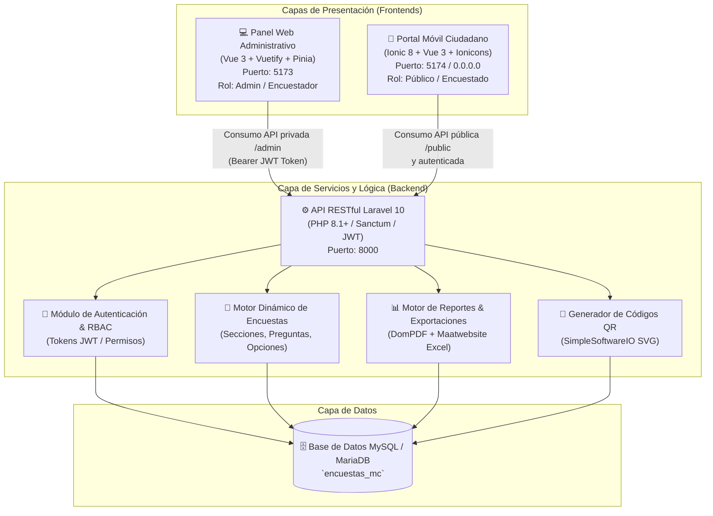

# 📋 LaQuestionES — Sistema Integral de Gestión de Encuestas e Indicadores Institucionales

> **Proyecto Final Interdisciplinario**  
> Materias: **UFDS, Metodologías de Desarrollo de Software y Desarrollo de Aplicaciones Móviles**  
> Repositorio: `Danny4lex/LaQuestionES` | Rama principal: `main`

---

## 🌟 Descripción General del Proyecto

**LaQuestionES** es una solución tecnológica integral diseñada para centralizar la creación, distribución, recolección y análisis estadístico de encuestas públicas y privadas con enfoque en instituciones gubernamentales y organizacionales (orientado al contexto del Ministerio de Cultura de El Salvador).

El ecosistema está construido bajo una **arquitectura desacoplada y modular** que consta de tres piezas principales trabajando en sinergia:

1. **Backend (API RESTful):** Desarrollado en **Laravel 10**, centraliza la lógica de negocio, autenticación JWT, control de accesos basado en roles (RBAC), auditoría completa, generación de códigos QR vectoriales y exportación de reportes analíticos en PDF y Excel.
2. **Frontend Web Administrativo:** Desarrollado con **Vue 3, Vuetify y Pinia**, diseñado para los administradores y encuestadores que gestionan el ciclo de vida de las encuestas, diseñan formularios dinámicos con *drag & drop*, revisan métricas en tiempo real y gestionan catálogos institucionales.
3. **Frontend Móvil (Portal Ciudadano):** Desarrollado con **Ionic 8 + Vue 3**, una aplicación móvil responsiva (orientada a smartphones y tablets) para que los encuestados y ciudadanos participen de forma ágil, táctil y sin fricciones en las encuestas públicas o mediante invitaciones.

---

## 🏗️ Arquitectura del Sistema



---

## 📂 Estructura del Repositorio

```text
LaQuestionES/
│
├── backend/                       # API RESTful en Laravel 10 (PHP 8.1+)
│   ├── app/                       # Modelos, Controladores, Middlewares, Políticas
│   ├── config/                    # Configuraciones de Laravel, JWT, PDF, etc.
│   ├── database/                  # Migraciones, factories y seeders demostrativos
│   ├── routes/
│   │   └── api.php                # Definición de rutas públicas y administrativas
│   ├── composer.json              # Dependencias de PHP / Laravel
│   └── .env                       # Variables de entorno del backend
│
├── frontend/                      # Panel Web Administrativo (Vue 3 + Vuetify + Vite)
│   ├── src/
│   │   ├── views/                 # Páginas: Dashboard, Constructor, Reportes, Catálogos
│   │   ├── components/            # Componentes reutilizables, modales, widgets
│   │   ├── services/              # Clientes HTTP (Axios) para consumo de la API
│   │   ├── stores/                # Estados globales con Pinia (Auth, Encuestas)
│   │   └── router/                # Rutas y guardias de navegación web
│   ├── vite.config.js             # Configuración de Vite con proxy hacia :8000
│   └── package.json               # Dependencias de Node.js
│
├── FrontedIonic/LaQuestionES-Ionic/ # Aplicación Móvil Ciudadana (Ionic 8 + Vue 3)
│   ├── src/
│   │   ├── views/                 # Vistas móviles: Lista, Detalle, Responder Encuesta
│   │   ├── services/              # Conexión al backend y API pública
│   │   ├── utils/                 # Manejo de encuestas completadas en almacenamiento local
│   │   ├── theme.css              # Paleta de colores y estilos institucionales
│   │   └── router/                # Navegación móvil con Ionic Vue Router
│   ├── vite.config.js             # Configuración Vite optimizada para dispositivos móviles
│   └── package.json               # Dependencias de Ionic y Vue
│
├── encuestas_mc.sql               # Dump SQL completo con estructura y datos iniciales
├── .gitignore                     # Exclusiones de Git
└── README.md                      # Documentación general del proyecto
```

---

## 🎯 Roles y Módulos de la Solución

### 1. ⚙️ Backend (Laravel 10 API)
- **Control de Acceso Granular (RBAC):** Roles de `Administrador`, `Encuestador` y `Encuestado`.
- **Constructor Jerárquico:** Encuesta ➔ Secciones ➔ Preguntas (Texto, Opción Única, Selección Múltiple, Escala de Satisfacción 1-5, Sí/No) ➔ Opciones.
- **Flujo de Aprobación y Estados:** Borrador ➔ En Revisión ➔ Publicada ➔ Cerrada. Incluye sistema de notas y observaciones por sección ("papelito" de correcciones).
- **Distribución de Encuestas:** Vía enlace público, código QR dinámico descargable (formato SVG), o por invitaciones a grupos/organizaciones con tokens individuales únicos.
- **Auditoría Integral:** Registro automático de historial de cambios (*change logs*) y sesiones activas (*session logs*).
- **Métricas y Reportería:** Cálculo de índices de satisfacción institucional, reportes desagregados por departamento, y descargas directas en formato **PDF** y **Excel (.xlsx)**.

### 2. 💻 Frontend Web (Vue 3 - Panel Administrativo)
- **Dashboard Estadístico:** Gráficos de barras, líneas y donas alimentados por Chart.js con KPIs en tiempo real.
- **Diseñador de Encuestas Visual:** Permite reorganizar secciones y preguntas mediante *drag & drop*, configurar obligatoriedad y agregar opciones dinámicamente.
- **Centro de Distribución:** Generación de enlaces públicos, códigos QR imprimibles y envíos de correo.
- **Gestión Institucional:** Árbol jerárquico de Unidades Organizacionales y catálogos paramétricos (tipos, estados y categorías).
- **Resultados y Pestaña por Encuestado:** Visualización detallada de respuestas individuales y exportación de reportes ejecutivos.

### 3. 📱 Frontend Móvil (Ionic 8 - Portal Ciudadano)
- **Experiencia Táctil (Mobile-First):** Diseñada específicamente para pantallas táctiles con botones ergonómicos, tarjetas interactivas e iconografía con **Ionicons**.
- **Acceso Sin Fricción:** Portal ciudadano público para responder encuestas sin necesidad de registro previo obligatorio.
- **Formularios Dinámicos Táctiles:**
  - Preguntas Sí/No con selector segmentado de un solo toque.
  - Escalas numéricas táctiles de 1 a 5 con retroalimentación visual de color.
  - Barra de progreso interactiva con porcentaje y conteo de preguntas respondidas en tiempo real.
- **Persistencia Local:** Historial de encuestas realizadas guardadas en el dispositivo móvil para evitar duplicidad y permitir revisión de estatus.
- **Diseño Responsivo Multiplataforma:** Compatible con navegadores móviles, preparado para despliegue en Android / iOS mediante Capacitor.

---

## 🚀 Requisitos Previos de Instalación

Asegúrate de contar con las siguientes herramientas instaladas en tu equipo de desarrollo:

- **PHP**: Versión `>= 8.1` o `8.2` (con extensiones `pdo_mysql`, `mbstring`, `openssl`, `gd`, `fileinfo`).
- **Composer**: Versión `2.x`.
- **Node.js**: Versión `18.x` o `20.x` LTS.
- **npm**: Versión `9.x` o superior.
- **Gestor de Base de Datos**: MySQL `8.x` o MariaDB `10.4+` (XAMPP, Laragon, Docker o servicio nativo).
- **Git**: Para el control de versiones.

---

## 🛠️ Guía de Puesta en Marcha (Paso a Paso)

### Paso 1: Configurar la Base de Datos

1. Inicia tu servidor de MySQL (por ejemplo desde el panel de XAMPP o Laragon).
2. Abre tu cliente SQL favorito (phpMyAdmin, DBeaver, HeidiSQL o terminal) y crea la base de datos:
   ```sql
   CREATE DATABASE encuestas_mc CHARACTER SET utf8mb4 COLLATE utf8mb4_unicode_ci;
   ```
3. Importa el archivo `encuestas_mc.sql` ubicado en la raíz del proyecto dentro de la base de datos `encuestas_mc` recién creada.

---

### Paso 2: Configurar y Levantar el Backend (Laravel)

1. Abre una terminal y navega a la carpeta del backend:
   ```bash
   cd backend
   ```
2. Instala las dependencias de PHP:
   ```bash
   composer install
   ```
3. Verifica o configura el archivo `.env` (si no existe, copia `.env.example` a `.env`):
   ```env
   APP_NAME=LaQuestionES
   APP_ENV=local
   APP_URL=http://127.0.0.1:8000

   DB_CONNECTION=mysql
   DB_HOST=127.0.0.1
   DB_PORT=3306
   DB_DATABASE=encuestas_mc
   DB_USERNAME=root
   DB_PASSWORD=

   JWT_SECRET=JmoabNG0oJGpjOlp0ObyfuNljPHbktOMK7tRusXA6R3sppSvVFzvyn7gzzk2vTaG
   ```
4. Genera la llave de la aplicación y la clave JWT (en caso de iniciar desde un `.env` limpio):
   ```bash
   php artisan key:generate
   php artisan jwt:secret
   ```
5. *(Opcional)* Si prefieres recrear la estructura y datos de prueba desde cero mediante migraciones:
   ```bash
   php artisan migrate:fresh --seed
   ```
6. Inicia el servidor de desarrollo:
   ```bash
   php artisan serve --port=8000
   ```
   > 🟢 **Backend activo en:** `http://127.0.0.1:8000`

---

### Paso 3: Configurar y Levantar el Frontend Web Administrativo (Vue 3)

1. Abre una **segunda terminal** y dirígete a la carpeta `frontend`:
   ```bash
   cd frontend
   ```
2. Instala las dependencias de Node.js:
   ```bash
   npm install
   ```
3. Verifica el archivo `.env`:
   ```env
   VITE_BACKEND_URL=http://127.0.0.1:8000
   VITE_API_BASE_URL=http://127.0.0.1:5173/api
   ```
   *(Nota: El archivo `vite.config.js` ya incluye un proxy interno que redirige las peticiones `/api` a `http://127.0.0.1:8000` transparentemente para evitar problemas de CORS).*
4. Inicia el servidor de desarrollo web:
   ```bash
   npm run dev
   ```
   > 🟢 **Panel Web activo en:** `http://localhost:5173`

---

### Paso 4: Configurar y Levantar la Aplicación Móvil (Ionic 8)

1. Abre una **tercera terminal** y navega a la carpeta móvil:
   ```bash
   cd FrontedIonic/LaQuestionES-Ionic
   ```
2. Instala las dependencias:
   ```bash
   npm install
   ```
3. Verifica el archivo `.env`:
   ```env
   VITE_BACKEND_URL=http://127.0.0.1:8000
   ```
4. Inicia la aplicación móvil en modo desarrollo:
   ```bash
   # Si el puerto 5173 ya está en uso por la web, Vite usará automáticamente el 5174:
   npm run dev -- --port 5174
   ```
   > 🟢 **Portal Móvil activo en:** `http://localhost:5174` (o la IP local mostrada en consola para probar desde un teléfono conectado a la misma red Wi-Fi).

---

## 🔑 Credenciales de Prueba (Seeders)

El sistema incluye cuentas preconfiguradas con distintos niveles de privilegio para validar todas las funcionalidades:

| Rol | Correo Electrónico | Contraseña | Alcance / Permisos |
| :--- | :--- | :--- | :--- |
| **Administrador** | `carlos.mendez@cultura.gob.sv` | `CulturaMC#2026` | Acceso total: creación, aprobación, eliminación, catálogos, auditoría y reportes globales. |
| **Encuestador** | `ana.ramirez@cultura.gob.sv` | `CulturaMC#2026` | Gestión y creación de encuestas pertenecientes a su unidad organizacional (`Dirección General Ejecutiva`). |
| **Encuestado** | `luis.portillo@cultura.gob.sv` | `CulturaMC#2026` | Usuario con perfil de respuesta para encuestas privadas institucionales. |

> 💡 **Nota:** Para el **Portal Ciudadano Móvil**, no se requiere iniciar sesión para participar en las encuestas con visibilidad **Pública**.

---

## 📡 Resumen de Endpoints Principales de la API

La API REST expuesta por Laravel se divide en dos grandes áreas:

### 🟢 Zona Pública (`/api/public/*`) — Sin Autenticación
- `GET /api/public/surveys` ➔ Listado de encuestas públicas activas.
- `GET /api/public/surveys/{survey}` ➔ Obtiene la estructura completa de una encuesta pública.
- `POST /api/public/surveys/{survey}/submit` ➔ Envío de respuestas anónimas ciudadanas.
- `GET /api/public/participants/{token}` ➔ Consulta de encuesta privada por token de invitación.
- `POST /api/public/participants/{token}/submit` ➔ Envío de respuestas de encuesta privada.

### 🔒 Zona Administrativa (`/api/*`) — Requiere Bearer JWT
- **Autenticación:**
  - `POST /api/auth/login` ➔ Inicio de sesión y emisión de token JWT.
  - `POST /api/auth/userInfo` ➔ Perfil del usuario autenticado y roles de encuestas.
- **Gestión de Encuestas:**
  - `GET /api/surveys` \| `POST /api/surveys` ➔ Listar y crear encuestas.
  - `PUT /api/surveys/{id}/structure` ➔ Sincronización masiva de secciones y preguntas.
  - `PATCH /api/surveys/{id}/status` ➔ Transición de estados (Borrador, Publicada, etc.).
  - `POST /api/surveys/{id}/duplicate` ➔ Duplicación/clonación rápida de encuestas existentes.
- **Códigos QR y Distribución:**
  - `GET /api/surveys/{id}/qr-code/image` ➔ Genera el código QR vectorial descargable.
  - `POST /api/email-notifications/send` ➔ Disparo de correos con enlaces únicos.
- **Métricas y Reportes:**
  - `GET /api/dashboard/summary` ➔ Métricas clave del sistema para el Dashboard.
  - `GET /api/reports/surveys/{id}/results` ➔ Resultados estadísticos agregados por pregunta.
  - `GET /api/reports/surveys/{id}/export-pdf` ➔ Descarga directa de reporte en PDF.
  - `GET /api/reports/surveys/{id}/export-excel` ➔ Descarga de hoja de cálculo en Excel.

---

## 👥 Equipo de Desarrollo y Contribuidores

Proyecto desarrollado como entregable final integrador por:

- **Steven Quintanilla** — [@StevenQuinta35](https://github.com/StevenQuinta35)
- **Claudia Menjívar** — [@cmenjivar21](https://github.com/cmenjivar21)
- **Danny Menjívar** — [@Danny4lex](https://github.com/Danny4lex)
- **Anderson Palma** — [@Palma0111](https://github.com/Palma0111)

---

## 📄 Licencia

Este proyecto fue desarrollado con fines académicos y de demostración institucional bajo la licencia **MIT**. Consulta los archivos de cada subdirectorio para más información.
